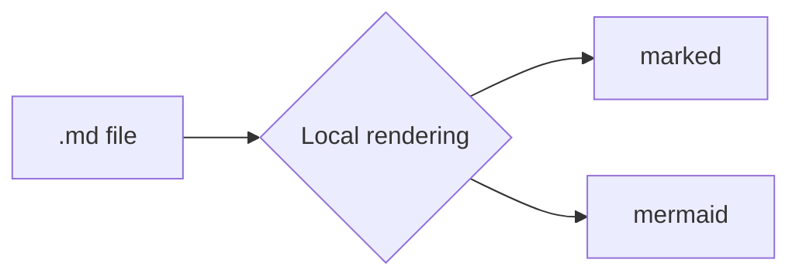
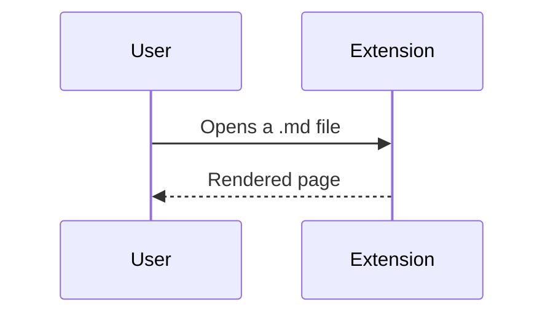

# Rendering example

Text with **bold**, *italic*, `code` and a [link](https://example.org).

## Table

| Column A | Column B |
|----------|----------|
| 1        | 2        |

## Tasks

- [x] Markdown rendering
- [ ] Browser validation

## Mermaid





## Code

```powershell
Get-ChildItem | Select-Object Name
```

## Security

<script>alert('blocked')</script>


